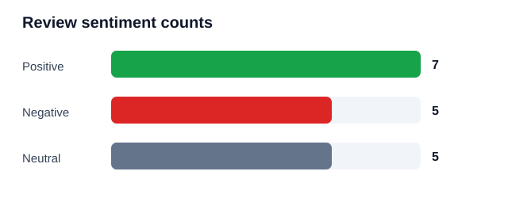

AI-Powered Sentiment Analysis and Text Classification

This small, runnable project classifies review text as **positive**, **negative**, or **neutral**. It uses a transparent lexicon-based NLP scoring technique: words in a sentiment vocabulary contribute positive or negative points, nearby negators reverse a word's polarity, and selected intensifiers increase its weight. Scores above zero are positive, below zero negative, and zero neutral.

## Run it

From this folder, run:

```powershell
python sentiment_analysis.py
```

The program prints the classification table, category totals, and results for three new examples. It also writes `classified_reviews.csv` and refreshes `sentiment_counts.svg`.

## Sample results

| ID | Review | Predicted category | Score |
|---:|---|---|---:|
| 1 | The staff were friendly and the service was excellent. | Positive | 3 |
| 2 | I love this phone; the camera is amazing. | Positive | 4 |
| 3 | Great quality and very comfortable to use. | Positive | 3.5 |
| 4 | Delivery was fast and the packaging was perfect. | Positive | 3 |
| 5 | A wonderful experience, I highly recommend it. | Positive | 3 |
| 6 | The app is smooth, helpful, and reliable. | Positive | 3 |
| 7 | Fantastic value for money and brilliant support. | Positive | 4 |
| 8 | It works as described. | Neutral | 0 |
| 9 | The color is blue and the box contains two pieces. | Neutral | 0 |
| 10 | I received the order on Tuesday afternoon. | Neutral | 0 |
| 11 | The product has a screen and a charging cable. | Neutral | 0 |
| 12 | The menu lists soup, rice, and tea. | Neutral | 0 |
| 13 | The delivery was late and the package was broken. | Negative | -2 |
| 14 | Poor quality; I am disappointed with this purchase. | Negative | -3 |
| 15 | The app is slow, annoying, and unhelpful. | Negative | -3 |
| 16 | Terrible service. I want a refund. | Negative | -3 |
| 17 | This was a waste of money and the worst experience. | Negative | -4 |

## Category totals

| Category | Count |
|---|---:|
| Positive | 7 |
| Negative | 5 |
| Neutral | 5 |



## Three new statements and manual verification

| New statement | Prediction | Expected label | Result |
|---|---|---|---|
| The headphones are fantastic and sound amazing. | Positive | Positive | Correct |
| The order arrived late and the item was broken. | Negative | Negative | Correct |
| The package contains a black notebook. | Neutral | Neutral | Correct |

Agreement with these three manually assigned labels: **3/3**.

This compact lexicon is intended for a classroom demonstration. It does not learn from context or a large training corpus, so sarcasm, domain-specific wording, and complex negation may be misclassified. The vocabulary and scoring rules can be edited in `sentiment_analysis.py`.
